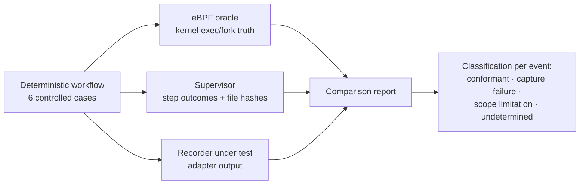

# AgentCaptureBench

**Does your capture tool actually see what executed?**

[](https://github.com/rafiimam/agent-capture-bench/actions/workflows/tests.yml)
[](LICENSE)
[](#validation-status)

Process-capture tools — eBPF tracers, audit pipelines, EDR sensors, deterministic recorders, AI-agent action logs — all claim to record what a system executed. Almost none of those claims are checked against an independent ground truth. A recorder can silently miss exactly the executions that matter most: the child process an interpreter spawned, the short-lived helper, the pipeline stage — and the log still *looks* complete.

**AgentCaptureBench is a ground-truth benchmark for process capture on Linux.** It runs a deterministic workflow under an independent eBPF oracle that observes process execution at kernel tracepoints, then scores a recorder-under-test against what the kernel actually saw — using a strict classification discipline that separates genuine capture failures from scope limitations and insufficient evidence.

> **Status: experimental, validated, first recorder comparison published.** On 2026-10-20 the eBPF oracle was built, loaded, and run on Ubuntu 24.04 ARM64 (kernel 6.8.0, Multipass VM): all 10 core checks and all 9 evasion-suite checks observed, including correct attribution of the Python-launched `git` child — and the first recorder comparison (BCC execsnoop) was run and classified. See [VALIDATION.md](VALIDATION.md) and [Results](#results).

## The test case that motivates this

```python
import subprocess
subprocess.run(['git', 'log', '-n', '1'], check=False)
```

A Python process launching `git` is where capture tools quietly diverge: hook-based recorders see the Python call but not necessarily the child process; syscall tracers see the exec but may lose the ancestry; sampling and buffering drop short-lived processes entirely. AgentCaptureBench exists to measure that divergence instead of arguing about it.

## How it works



Three independent evidence streams, none derived from the recorder's own output:

- **The oracle** observes successful process image changes via `sched:sched_process_exec`, captures bounded argv at `sys_enter_execve` / `sys_enter_execveat`, and reconstructs parent/child relationships from `sched:sched_process_fork`. Output: `oracle-events.jsonl`.
- **The supervisor** records whether each named workflow step completed, its return code, and before/after SHA-256 hashes of a controlled file. Output: `supervisor-events.jsonl`.
- **The recorder under test** is whatever you are evaluating, adapted to a documented JSONL format. Output: `recorder-output.jsonl`.

**The oracle is not omniscient, and this project will not pretend otherwise.** It logs successful exec events, not every failed `execve()` attempt; it captures at most 8 argv elements of 95 bytes each; a tracepoint is a ground truth for *process execution*, not for all system activity. A missing event is classified **undetermined** until oracle permissions, scenario execution, configuration, and buffering have all been checked.

## Quickstart

Requirements: Linux with eBPF and ring-buffer support; the tracepoints `syscalls:sys_enter_execve`, `syscalls:sys_enter_execveat`, `sched:sched_process_fork`, `sched:sched_process_exec`, `sched:sched_process_exit`; Clang with a BPF backend; `libbpf-dev`, `libelf-dev`, `zlib1g-dev`; permission to load eBPF (root or `CAP_BPF`/`CAP_PERFMON`); Python 3 and Git.

On Debian/Ubuntu:

```bash
sudo apt update
sudo apt install clang llvm libbpf-dev libelf-dev zlib1g-dev make gcc git python3

git clone https://github.com/rafiimam/agent-capture-bench.git
cd agent-capture-bench
make
./run_experiment.sh
```

`run_experiment.sh` prepares a tiny local Git fixture, runs the workflow under the oracle (via `sudo`; the loader drops the target child back to your `SUDO_UID`/`SUDO_GID`), and writes a fresh `.work/run-*/` directory per run containing `oracle-events.jsonl`, `supervisor-events.jsonl`, and `oracle-report.json`. Building successfully does not imply the host permits BPF loading — if the oracle cannot attach, the run is classified undetermined, not failed.

Manual invocation, the event schema, and the root-target override are documented in [Running manually](#running-manually) below.

## What the current scenario checks

Scenario `python-subprocess-capture-v1` ([workflow/scenario.yaml](workflow/scenario.yaml)) runs six controlled cases:

| Case | What happens | What it probes |
|---|---|---|
| `path_echo` | `echo hello` resolved through `PATH` | PATH-resolved execution visibility |
| `absolute_echo` | `/bin/echo absolute` by absolute path | Direct execution visibility |
| `shell_pipeline` | Pipeline of `/bin/echo` and `/usr/bin/wc` | Multi-process pipeline stages |
| `nonzero_exit` | `/usr/bin/false` returns status 1 | Executed-but-failed commands |
| `python_spawns_git` | Python `-c` → `subprocess.run(['git', 'log', '-n', '1'])` | **Interpreter-launched child processes** |
| `file_modification` | Controlled file write, SHA-256 before/after | Filesystem effect accounting |

## Results

Recorder comparisons will be published here as adapters land and runs are validated. No composite scores — coverage, field accuracy, ordering/correlation, redaction, integrity, and overhead are reported separately, with exact recorder versions, permissions, platform, and configuration pinned per run.

| Recorder | Version | `path_echo` | `absolute_echo` | `shell_pipeline` | `nonzero_exit` | `python_spawns_git` | `file_modification` |
|---|---|---|---|---|---|---|---|
| execsnoop (BCC) | Ubuntu 24.04 bpfcc-tools, 2026-10-20 | ✓* | ✓ | ✓* | ✓ | ✓* | — (filesystem effect, out of scope) |

\* Captured — present in the recorder's stream, but exact-argv matching could not pair it with the oracle event for representation reasons (argv[0] resolved vs as-invoked; space-joined text argv vs the oracle's 95-byte bound). Across the full core+evasion run: 38 oracle exec events, 27 exact matches, 11 representation differences, **zero genuine capture misses**; 224 recorder-only events were system background outside the oracle's tracked tree. Full classification analysis: [VALIDATION.md](VALIDATION.md).

See [docs/LANDSCAPE.md](docs/LANDSCAPE.md) for the recorders and capture tools this benchmark is designed to evaluate, and what each one claims.

## Classification discipline

Every compared event lands in exactly one class:

- **Conformant** — the output matches the documented capture guarantee.
- **Capture failure** — an event covered by the stated guarantee is missing or incorrect.
- **Scope limitation** — the event is outside the stated guarantee, and that boundary is explicit.
- **Undetermined** — insufficient evidence to distinguish a recorder miss from a workflow, permission, oracle, configuration, or buffering problem.

A recorder is not defective merely because it does not capture OS-level child processes when it promises only agent lifecycle hooks. Likewise, a signed or hash-chained record establishes integrity of the recorded bytes without establishing completeness of capture. This discipline — especially the refusal to call unproven misses "failures" — is the point of the benchmark.

## Oracle event schema

Every non-metadata line in `oracle-events.jsonl` carries:

- `record_type`: `event`
- `seq`: userspace delivery sequence (not a guaranteed cross-CPU kernel total order)
- `pid`, `ppid`, `old_pid`, `comm`, `filename`
- `argv`, `argc`, `args_truncated`

`ppid: 0` means unknown in this prototype; do not interpret it as proof of a root process. Fork records establish ancestry, while exec records are emitted when the kernel reports a successful image change. Arguments may be truncated, and reports must preserve that uncertainty.

## Running manually

```bash
mkdir -p .work
python3 workflow/prepare_fixture.py --dir .work/fixture
sudo build/agentcap-oracle \
  --output .work/oracle-events.jsonl -- \
  "$(command -v python3)" "$PWD/workflow/run_workflow.py" \
  --fixture-dir "$PWD/.work/fixture" \
  --events "$PWD/.work/supervisor-events.jsonl"
python3 tools/report.py \
  --oracle .work/oracle-events.jsonl \
  --supervisor .work/supervisor-events.jsonl \
  --output .work/oracle-report.json
```

The fixture script refuses to reuse an existing Git repository, preventing accidental mixing of observations across experiments. If you run as root without `SUDO_UID`/`SUDO_GID`, the tool refuses to run the target unless you pass `--allow-root-target` — use that override only inside an isolated test environment.

## Scenario suites

- **Core** (`--suite core`, default): the six cases above, scenario `python-subprocess-capture-v1`.
- **Evasion** (`--suite evasion` or `ACB_SUITE=all ./run_experiment.sh`): scenario `capture-evasion-v1` ([workflow/scenario-v2.yaml](workflow/scenario-v2.yaml)) — shell `-c` indirection, the `execveat` syscall, double-fork daemonization (which orphans the real worker), a burst of 20 short-lived processes, argv deliberately beyond the oracle's 8×95-byte bounds (the truncation flag is the expected observation), and direct execution of a shell script. On macOS, run everything inside a Multipass Ubuntu VM — see [docs/MACOS_VM.md](docs/MACOS_VM.md).

## Roadmap

- **Recorder adapters** — first two implemented: [BCC `execsnoop` and auditd](adapters/README.md). Next: Tetragon, Falco, and agent recorders such as DEPOSE and Tracekit ([adapter proposal template](.github/ISSUE_TEMPLATE/recorder_adapter.md)).
- **Scenario families** — evasion suite implemented (above), pending host validation. Session interruption, secret redaction, and tamper detection become separate families after the Linux oracle is validated.
- **First validated host run** — publish kernel/distribution/compiler versions, capabilities, raw JSONL, and the report (see [VALIDATION.md](VALIDATION.md)).
- **macOS** — phase 2, not implemented.

Pre-written starter issues are collected in [docs/INITIAL_ISSUES.md](docs/INITIAL_ISSUES.md).

## Validation status

**Core scenario validated on a real host (2026-10-20).** Ubuntu 24.04.5 LTS (aarch64, kernel 6.8.0-147-generic) in a Multipass VM on Apple Silicon; clang 18.1.3, libbpf 1.3.0. The build initially failed on two genuine portability bugs — clang's BPF backend has no `memset` libcall, and its loop-idiom pass kept recreating one — both fixed (see [VALIDATION.md](VALIDATION.md)). The validated run observed all 10 core checks, 17 oracle events (9 exec, 8 fork), 5/5 supervisor steps. The evasion suite and recorder comparisons are being validated the same way and will be recorded in VALIDATION.md as they complete; anything not yet run is stated as such, and a failed or unmatched run is classified *undetermined* until the oracle side is ruled out.

## Contributing

Contributions are welcome — especially recorder adapters, new scenario families, and validation reports from real hosts. See [CONTRIBUTING.md](CONTRIBUTING.md) for setup and the classification discipline contributions must follow, and the issue templates for bug reports, validation reports, and adapter proposals.

## Useful technical references

- Linux tracepoint eBPF program type: <https://docs.ebpf.io/linux/program-type/BPF_PROG_TYPE_TRACEPOINT/>
- libbpf-bootstrap process execution example: <https://github.com/libbpf/libbpf-bootstrap>
- Kernel tracepoint program sections: <https://kernel.org/doc/html/latest/bpf/libbpf/program_types.html>

## License

MIT. See [LICENSE](LICENSE).
